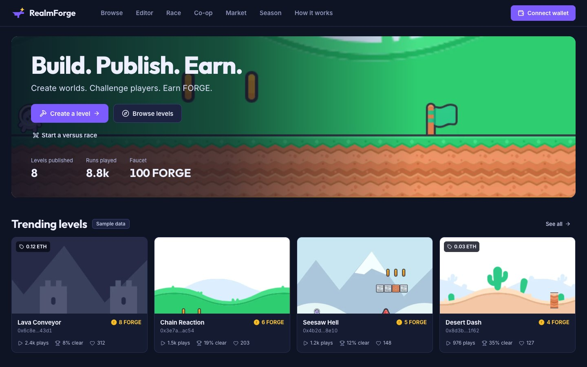
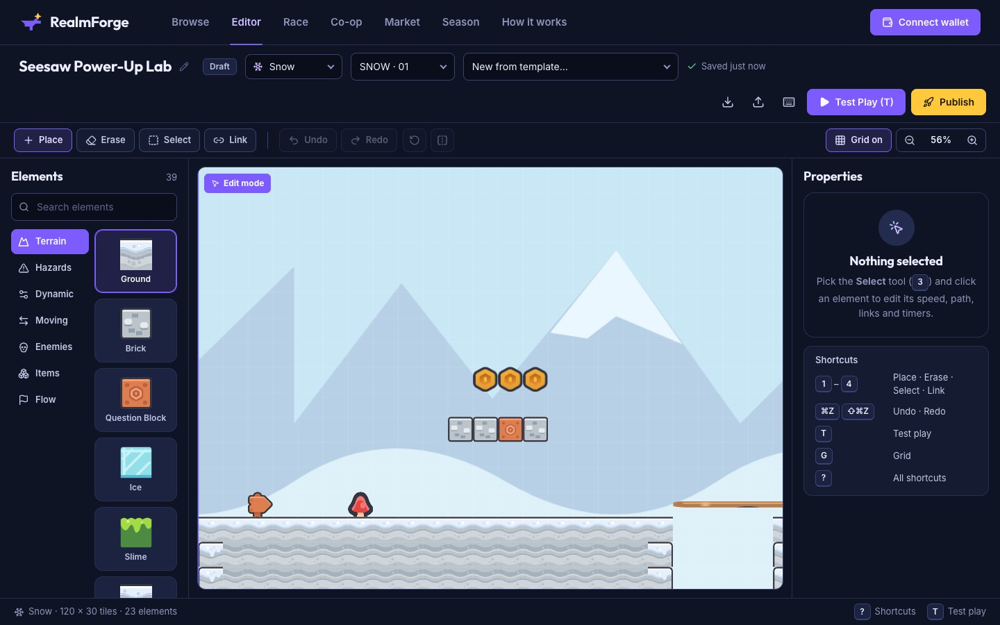
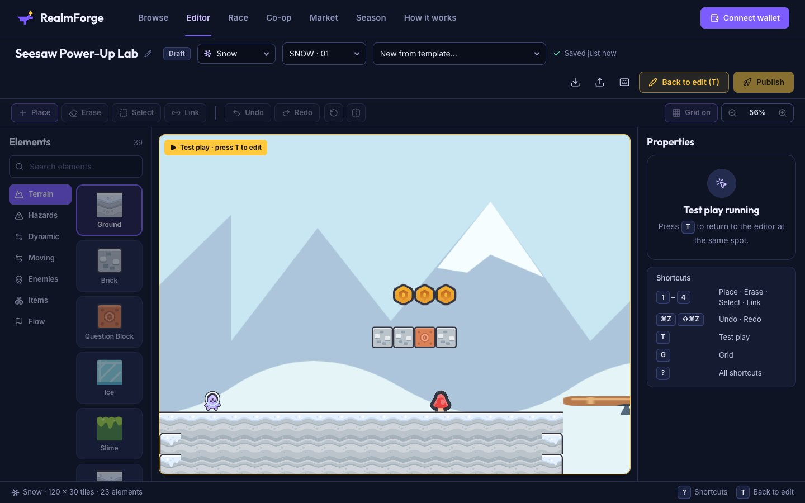
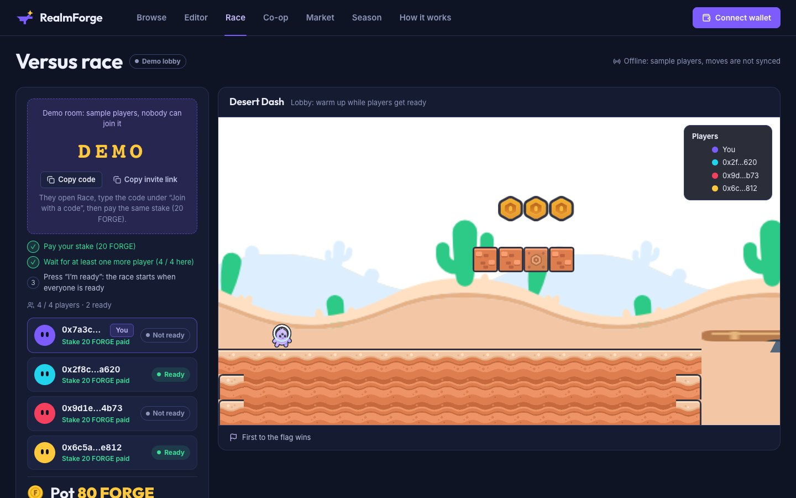
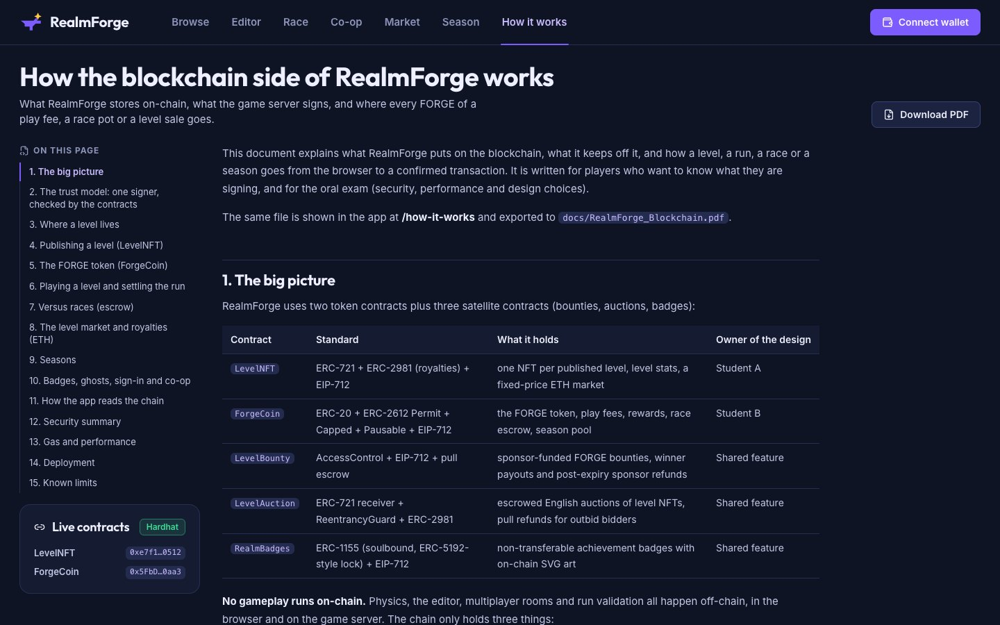
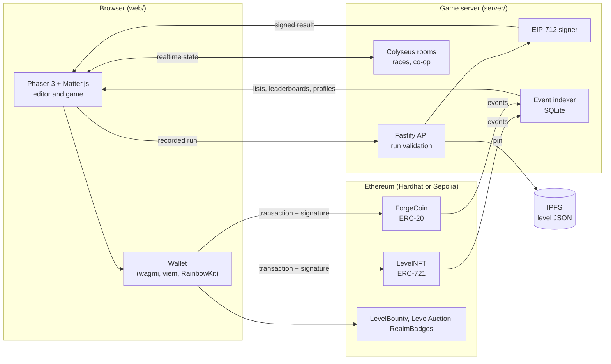
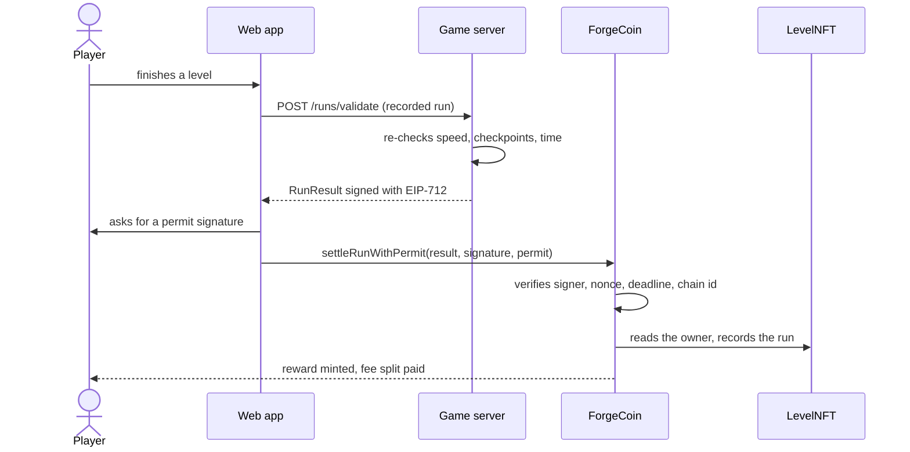

<div align="center">

# RealmForge

**Build a platformer level. Publish it as an NFT. Earn FORGE when others play it.**

A browser game in the spirit of level-maker platformers, with a real on-chain economy:
levels are ERC-721 tokens, play fees and rewards are an ERC-20 token, and races are staked in escrow.

[](LICENSE)
[](assets/CREDITS.md)




</div>

---

## Contents

- [What it is](#what-it-is)
- [Screenshots](#screenshots)
- [How it works](#how-it-works)
- [Smart contracts](#smart-contracts)
- [The FORGE economy](#the-forge-economy)
- [Tech stack](#tech-stack)
- [Repository layout](#repository-layout)
- [Getting started](#getting-started)
- [Testing](#testing)
- [Security](#security)
- [Assets and licensing](#assets-and-licensing)
- [Documentation](#documentation)
- [Authors](#authors)

## What it is

RealmForge was built for the **Blockchain BK-01** university module. The goal was a complete DApp that answers a real
need: a creator economy for user-made game levels.

| Role | What they do |
|---|---|
| **Creator** | Builds a level in the in-browser editor, clears it once to prove it can be beaten, and mints it as an NFT. Earns a share of every play fee and royalties on resale. |
| **Player** | Plays any published level, pays its fee in FORGE, and earns FORGE rewards for clearing it and setting records. |
| **Racer** | Stakes FORGE in a versus race (2 to 4 players) on a level and wins the pot. |
| **Collector** | Buys, sells and auctions level NFTs. |

Features:

- **Level editor** with 38+ placeable elements (terrain, enemies, hazards, moving platforms, seesaws, springs, checkpoints, doors, switches, power-ups), undo and redo, templates, copy and paste, and instant test-play.
- **Platformer physics** on Phaser 3 and Matter.js: fixed 60 Hz step, fixed-point maths, coyote time, jump buffering, wall slide and wall jump. Deterministic, so a recorded run can be validated on the server.
- **Publish as an NFT**: a level is minted only after a server-checked clear. The level JSON lives on IPFS, only its hash is stored on-chain.
- **Solo play and settlement** in a single transaction (ERC-2612 permit), or gasless through a relayer.
- **Versus races** with stake escrow, a live view of the other players, respawn and give-up, and a signed ranking that anyone can submit.
- **Co-op rooms and spectators**, **ghost replays** and **Sign-In With Ethereum**.
- **Seasons** with a 30-day prize pool shared between top players and top creators.
- **Market and auctions** for level NFTs with ERC-2981 royalties, **bounties** funded in FORGE, and **soulbound achievement badges**.

## Screenshots

<table>
  <tr>
    <td width="50%"><br><sub><b>Level editor</b>: place elements, link switches, test-play instantly.</sub></td>
    <td width="50%"><br><sub><b>Play</b>: fixed-step physics, checkpoints, timer and coin counter.</sub></td>
  </tr>
  <tr>
    <td width="50%"><br><sub><b>Versus race</b>: room code, stake escrow, live ranking.</sub></td>
    <td width="50%"><br><sub><b>How it works</b>: the in-app explanation of the trust model.</sub></td>
  </tr>
</table>

## How it works

No gameplay runs on-chain. Physics, the editor, race rooms and run validation happen off-chain, in the browser and on a
game server. The chain holds only three things: **ownership** of levels, the **economy** (FORGE balances, fees, rewards,
stakes, prizes) and the **settlement** of signed results.



### Settling a run



### The trust model

The contracts cannot watch a game, so the **game server signs the outcome** and the contracts verify the signature:
authorised signer, unused nonce, deadline, chain id and verifying contract are all bound into the EIP-712 message. This is a
deliberate, documented centralisation point: a compromised signer key could sign false results. It is mitigated by signer
rotation, a pause switch, per-player daily caps and public events that let anyone recompute rankings. See the
[threat model](docs/security/THREAT_MODEL.md) for the full analysis.

## Smart contracts

All contracts use OpenZeppelin 5, custom errors, `AccessControl`, pull payments and reentrancy guards.

| Contract | Standard | Role |
|---|---|---|
| [`LevelNFT`](contracts/src/LevelNFT.sol) | ERC-721, ERC-2981, EIP-712 | Mints levels after a server-signed clear proof, remixes with lineage, fixed-price market, royalties, pull-payment withdrawals. |
| [`ForgeCoin`](contracts/src/ForgeCoin.sol) | ERC-20, ERC-2612 Permit, Capped, Pausable | The FORGE token: faucet, run settlement, fee split and burn, race escrow, seasons. |
| [`LevelBounty`](contracts/src/LevelBounty.sol) | FORGE escrow | Sponsors lock FORGE on a level; the first signed qualifying clear takes the pot, expired bounties are refunded. |
| [`LevelAuction`](contracts/src/LevelAuction.sol) | ETH escrow | Timed English auctions for level NFTs with pull payments. |
| [`RealmBadges`](contracts/src/RealmBadges.sol) | ERC-1155 (soulbound), EIP-712 | Achievement badges claimed with a server-signed message. |

### Sepolia deployment

| Contract | Address |
|---|---|
| ForgeCoin | [`0x5d40434c1B59F4f2Be0B986373C074571133421e`](https://sepolia.etherscan.io/address/0x5d40434c1B59F4f2Be0B986373C074571133421e#code) |
| LevelNFT | [`0xC040D6E51e6e59f1764Bc30c1Cf5fB40E4736f09`](https://sepolia.etherscan.io/address/0xC040D6E51e6e59f1764Bc30c1Cf5fB40E4736f09#code) |

Both are verified on Etherscan. The three other contracts are deployed by `npm run deploy:local` on a local chain.

## The FORGE economy

FORGE has a hard cap of 100,000,000. It enters circulation through a faucet and clear rewards, and leaves through burning.

| Rule | Value |
|---|---|
| Faucet | 100 FORGE once per address, with a global budget of 10,000 FORGE per UTC day |
| Play fee | Set by the creator (100 FORGE maximum) |
| Fee split | 70 % level owner, 20 % season pool, 10 % treasury (half of the treasury share is burned) |
| Clear reward | 5 base + up to 45 difficulty bonus (capped at 50), +20 for the first clear of a level, +10 for a new record, +0.1 per coin (max 5) |
| Daily reward cap | 200 FORGE minted per player and day |
| Self-play | The owner or creator pays the fee but earns no reward and no statistics |
| Race payout | 60 % first, 25 % second, 10 % level owner, 5 % season pool |
| Race refund | A race that is never settled can be refunded after 1 hour |
| Seasons | 30 days; the pool is split 50 / 50 between players and creators (top 10 each) from a server-signed ranking, see [SEASONS.md](docs/SEASONS.md) |

## Tech stack

| Layer | Technology |
|---|---|
| Contracts | Solidity 0.8.28, OpenZeppelin 5, Hardhat 3, Hardhat Ignition, viem, forge-std tests, Slither |
| Game engine | Phaser 3.90, Matter.js, deterministic fixed-point controller in TypeScript (`game-core/`) |
| Web app | React 19, Vite, wagmi 2, viem, RainbowKit |
| Server | Fastify 5, Colyseus 0.16, viem, `node:sqlite`, zod |
| Storage | IPFS (local pinner or Pinata), SQLite indexer |

## Repository layout

```
contracts/   Smart contracts, Solidity and TypeScript tests, Ignition deployment, ABI export
game-core/   Pure TypeScript platformer controller, element registry, replay encoder, labs
server/      Fastify API, Colyseus rooms, EIP-712 signer, event indexer, season scoring
web/         React app: pages, level editor, play and race scenes, contract hooks
assets/      CC0 asset sources, build scripts and licence records
scripts/     Local deployment helper, browser end-to-end driver, UI art capture
docs/        Specification, blockchain explanation, security reports, gas report
```

Each folder is a standalone npm project with its own `package.json` and lockfile. The root `package.json` only holds
convenience scripts.

## Getting started

Requirements: **Node.js 22.13 or newer** (the server uses `node:sqlite`) and a browser wallet such as MetaMask.

```bash
git clone https://github.com/salma-mahjoub/realmforge.git
cd realmforge
npm run setup            # npm ci in game-core, contracts, server and web (a few minutes)
```

Start the stack in three terminals.

```bash
npm run dev:chain        # 1. local Hardhat chain on :8545 (chain id 31337)
```

```bash
npm run deploy:local && rm -rf server/data/local-* && npm run dev:server   # 2. deploy, reset the indexer, start API + rooms
```

```bash
npm run dev:web          # 3. the web app, usually http://localhost:8080
```

`deploy:local` deploys the contracts, exports their ABIs and writes `web/.env.local` and `server/.env`. After every
restart of the local chain, run it again, clear the indexer data as above, and reset the activity of your wallet accounts
(MetaMask: Settings, Advanced, Clear activity tab data); otherwise stored nonces no longer match the fresh chain.

### Wallet setup

Add a network with RPC `http://127.0.0.1:8545` and chain id `31337`, then import two or three of the funded accounts
printed by `npm run dev:chain` (public Hardhat test keys, for local use only). Account #1 is the game server's signing key:
do not use it in the browser.

### Play through the whole flow

1. Claim **100 FORGE** from the faucet.
2. Build a level in the editor, test-play it to the flag, then **Publish** (four steps: thumbnail, IPFS pin, server-checked clear proof, mint).
3. Switch account, claim the faucet, play the level and **settle** the run: the creator earns the fee, the player earns the reward.
4. Create a **versus race** with one account, join it with the room code from another, and settle the signed ranking.
5. List the NFT on the **market** and buy it with a third account.

The same flow as a timed demo script is in [docs/DEMO.md](docs/DEMO.md).

### Sepolia

```bash
cd server && set -a && . ./.env.sepolia && set +a && npm run dev     # server on Sepolia
cd web && npm run dev -- --mode sepolia                               # web app on Sepolia
```

Copy `server/.env.example` and `web/.env.example`, fill in your RPC URL, deployed addresses and a signer key, and keep
secrets out of git. Redeploy with `cd contracts && npm run deploy:sepolia`.

## Testing

```bash
npm test                 # all four suites
npm run build            # builds every package
npm run e2e:chain        # scripted faucet, publish, validate and settle flow on the local chain
npm run e2e:race         # scripted race: escrow, signed ranking, payout, expiry, refund
npm run e2e:season       # scripted season close with the server-signed ranking
npm run e2e:browser      # drives the real UI with an injected test wallet (needs Playwright)
```

| Suite | Tests |
|---|---|
| Smart contracts (Solidity unit, fuzz and invariant tests, plus TypeScript integration tests) | 126 |
| Server | 96 |
| Web | 126 |
| game-core | 87 |

## Security

- Signature checks bind the signer, a one-time nonce, a deadline, the chain id and the contract address.
- Payments use the pull pattern, `nonReentrant` and checks-effects-interactions; every state change emits an event.
- Static analysis with Slither found no high or medium issue ([report](docs/security/SLITHER.md)).
- A written [threat model](docs/security/THREAT_MODEL.md) covers the centralised signer and its mitigations, and a [gas report](docs/GAS.md) compares L1 and L2 costs.
- The server signs each recorded run once per level, so a winning run cannot be replayed to farm rewards.

This is a university project and has not been audited. Do not use it with real funds.

## Assets and licensing

- **Code**: MIT, see [LICENSE](LICENSE).
- **Art, sound and music**: every asset in this repository is **CC0**, mainly the [Kenney](https://kenney.nl) packs, plus a few CC0 music tracks from OpenGameArt and original supplemental art. Sources, hashes and licences are recorded in [assets/CREDITS.md](assets/CREDITS.md).
- RealmForge is an independent project. It is inspired by the level-maker genre, contains no third-party game IP, and is not affiliated with or endorsed by any game publisher.

The game loads its art from a manifest (`web/public/assets/manifest.json`), so another asset pack can be added by serving a
manifest with the same schema.

## Documentation

| Document | Content |
|---|---|
| [docs/SPEC.md](docs/SPEC.md) | Technical specification |
| [docs/BLOCKCHAIN.md](docs/BLOCKCHAIN.md) | How the blockchain side works, with diagrams ([PDF](docs/RealmForge_Blockchain.pdf)) |
| [docs/SEASONS.md](docs/SEASONS.md) | Season ranking rules |
| [docs/GAS.md](docs/GAS.md) | Gas cost per function |
| [docs/security/](docs/security/) | Threat model and Slither report |
| [docs/DEMO.md](docs/DEMO.md) | Demo script |
| Package READMEs | [contracts](contracts/README.md), [game-core](game-core/README.md), [server](server/README.md), [web](web/README.md) |

## Authors

Built by a team of two for the Blockchain BK-01 module.

- [**Mohamed Slimane**](https://github.com/MedSlimane): `LevelNFT`, the level editor, the publish flow and the market.
- [**Salma Mahjoub**](https://github.com/salma-mahjoub): `ForgeCoin`, the economy and settlement, race and season logic, server-side signing, and the test and security reports.

The game engine, the server and the web app were built together.

## License

[MIT](LICENSE)
